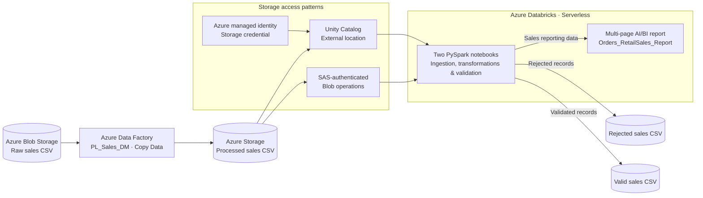

# Sales Analytics Pipeline | Azure Databricks & Azure Data Factory

An Azure-based data engineering and analytics solution that moves retail sales data through a controlled ingestion and transformation workflow, separates records by validation outcome, and presents results in a multi-page Databricks AI/BI report.

The implementation combines **Azure Data Factory**, **Azure Blob Storage / ADLS Gen2**, **Azure Databricks Serverless**, **PySpark**, and **Unity Catalog**. The repository contains the Databricks notebooks, ADF configuration artifacts, and the report definition.

## Solution Architecture



> The diagram shows the two storage-access approaches implemented in the project. They are alternative integration patterns, not two mandatory sequential ingestion steps.

## Pipeline Design

| Layer | Implementation | Responsibility |
|---|---|---|
| Ingestion | Azure Data Factory (`PL_Sales_DM`) | Copies the source sales CSV from the raw Blob location to the processed location. |
| Storage | Azure Blob Storage / ADLS Gen2 | Holds source, processed, valid, and rejected sales files. |
| Processing | Two Databricks notebooks running on serverless compute | Read sales data, apply PySpark transformations and validation logic, and write valid/rejected outputs. |
| Storage integration | SAS-based operations and Unity Catalog external locations | Support direct Blob operations and centrally governed access through Azure managed identity. |
| Analytics | Databricks AI/BI | Delivers a multi-page retail sales report. |

## Implementation Highlights

- **Separation of ingestion and transformation:** ADF handles the raw-to-processed copy; Databricks handles data preparation and validation.
- **Validation-based output routing:** Sales records are separated into valid and rejected CSV outputs for downstream use or review.
- **Two Azure storage access patterns:** The notebooks cover SAS-authenticated Blob operations and Unity Catalog-governed access using an external location and storage credential.
- **Serverless execution:** Data processing runs on Azure Databricks Serverless Compute.
- **Report as code:** The multi-page AI/BI report is versioned as a Databricks dashboard definition (`.lvdash.json`).

## Repository Structure

```text
Sales_Analytics_Project_ADB/
│
├── ADF/
│   ├── dataset/                       # ADF source and destination datasets
│   ├── factory/                       # Azure Data Factory configuration
│   ├── linkedService/                 # Azure Storage connection definitions
│   ├── pipeline/                      # PL_Sales_DM copy pipeline (Raw → Processed)
│   └── publish_config.json           # ADF publishing configuration
│
├── Notebooks/
│   ├── 01-Sales_Cleaning.ipynb        # PySpark transformations and data validation
│   └── 02-OrdersFromCSV.ipynb         # Sales data ingestion and processing
│
├── Orders_RetailSales_Report.lvdash.json   # Multi-page Databricks AI/BI report
│
└── README.md                                # Project documentation
```

## Source Control & Deployment

The solution integrates **Azure Data Factory and Azure Databricks with GitHub** to support centralized version control and organized development workflows.

### Azure Data Factory
- Integrated directly with GitHub using `/ADF` as the repository root.
- Pipeline, dataset, linked service, and factory configurations are maintained as JSON files.
- The `PL_Sales_DM` pipeline copies sales data from the raw storage location to the processed storage location.
- Changes are committed to GitHub and published separately to the live Azure Data Factory environment.

### Azure Databricks
- Integrated with GitHub through Databricks Git folders.
- PySpark notebooks are version-controlled alongside the multi-page Databricks AI/BI report.
- Unity Catalog governs access to Azure Storage through managed identities and external locations.
- Serverless Compute is used for notebook execution and data processing.

### Repository Organization
The repository separates orchestration, data transformation, and reporting components while maintaining a unified codebase for the end-to-end Azure Sales Analytics solution.

## Reproducing the Solution

1. Provision or identify Azure Storage, Azure Data Factory, and a Unity Catalog-enabled Azure Databricks workspace.
2. Configure the ADF linked services and datasets for your own raw and processed Blob paths; publish and run `PL_Sales_DM`.
3. Configure the required Azure storage permissions. For governed ADLS Gen2 access, register the managed-identity storage credential and external location in Unity Catalog.
4. Import or sync the notebooks, update environment-specific storage paths and catalog references, and run the transformation and validation logic on serverless compute.
5. Import `Orders_RetailSales_Report.lvdash.json` into Databricks and reconnect its queries to the appropriate data objects if necessary.

**Configuration and security:** The repository contains project definitions, not provisioned Azure resources. Storage account names, resource IDs, access permissions, and report bindings may need updating in another environment. Never commit SAS tokens, storage keys, or other credentials.

## Technology Stack

**Azure Data Factory** · **Azure Blob Storage / ADLS Gen2** · **Azure Databricks Serverless** · **PySpark / Python** · **Unity Catalog** · **Azure Managed Identity** · **Databricks AI/BI Dashboards** · **GitHub**
